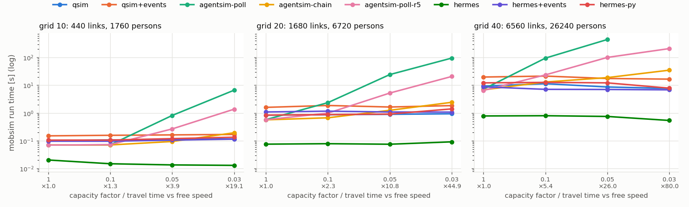
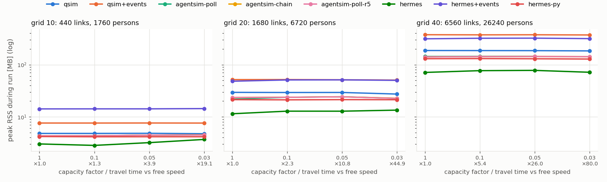

# Mobsim scaling: run time and peak memory vs network size and congestion

*Run 2026-11-03 (HermesSim rows 2026-11-04) on commit `342cb3f` (dirty tree), Python 3.12.8, Intel i5-8350U
(laptop, 1.7 GHz, single-threaded runs), Linux. Reproduce with
`uv run python -m benchmarks.mobsim_sweep` then
`uv run python -m benchmarks.mobsim_sweep_report`.*

## Summary

- **HermesSim (Rust kernel) is the fastest mobsim at every size and
  congestion level**: 0.54–0.80 s on the 40×40 grid against 7.7–11.4 s for
  QSim (12–14×), and 0.075–0.09 s against 0.83–0.94 s on the 20×20 grid. Its
  kernel takes about 180 ns per link traversal against QSim's 6.5 µs. The
  rest of its time is Python, mostly encoding the plans (`PlanBatch`, about
  0.22 s on grid 40). Like QSim it is flat under congestion, and it uses
  about 40% of QSim's memory (71–78 MB on grid 40). Its congested travel
  times are within 1% of QSim's (×79 against ×80).
- **QSim's run time does not depend on congestion.** On every grid it stays
  flat from free flow to travel times 80× free speed. It scales with the
  number of link traversals at about **6.5 µs per traversal**.
- **AgentSim is the fastest variant at free flow**: 25–30% faster than QSim
  (about 4.8 µs per traversal).
- **AgentSim with `blocked="poll"` falls apart under spillback.** Its cost
  grows with the number of blocked agent-seconds. On the 40×40 grid at
  capacity 0.05 it took 447 s against 8.7 s for QSim (51×). At capacity 0.03
  it was not run, because it would have taken more than 20 minutes.
- **A 5 s retry interval cuts the polling cost by 4–5×** but is still
  12–27× slower than QSim under heavy congestion. It also changes results
  slightly, because blocked vehicles react up to 5 s late.
- **AgentSim with `blocked="chain"` gives the same results as `poll`
  and is almost always the fastest AgentSim.** Under heavy spillback it is
  still 1.6–4.6× slower than QSim at the heaviest level. The gap widens with network size,
  because blocking chains get longer.
- **Memory is set by population size, not congestion.** Peak RSS is about
  7.3 kB per person for QSim and 5.5 kB per person for AgentSim, flat
  across congestion levels.
- **Recording every event (`EventLog`) roughly doubles both time and
  memory**: 3.07 M events cost about 190 MB, around 64 B per event. Nothing
  in a normal iteration needs events. Travel times, scores and experienced
  plans are all built from the trajectory arrays.
- **No agent got stuck** in any run, even with `stuck_time=inf`. Every jam
  eventually cleared.

## Setup

| | |
|---|---|
| Network | `grid_network(size, spacing=200 m, capacity=600 veh/h)`, freespeed 10 m/s, 1 lane, both directions. Sizes 10, 20, 40 give 440, 1,680 and 6,560 links |
| Demand | 4 car commuters per link (1,760 / 6,720 / 26,240 persons). Random home and work nodes, home→work→home, leaving home uniformly between 06:00 and 08:00, 8 h at work. Routed once at free speed |
| Congestion | `flow_capacity_factor = storage_capacity_factor` ∈ {1, 0.1, 0.05, 0.03}, the same as running a 100%, 10%, 5% or 3% sample at full demand. With 200 m links and a 7.5 m cell, a factor of 0.03 leaves about 1 vehicle of storage and 18 veh/h of flow per link |
| Stuck time | `inf` for every run. Vehicles are never forced onto a full link |
| Measured | Each cell runs in a fresh subprocess, from a pickled routed scenario. **Time** is the wall time of `mobsim.run` only: best of up to 5 runs within a 3 s budget, and a single run for anything slower. **Peak memory** is the process's peak RSS during the first run minus its RSS just before the run (the Linux `VmHWM` counter, reset via `/proc/self/clear_refs`). It counts everything the run allocates, Python or native |
| Congestion indicator | Total experienced leg travel time divided by total free-speed route time, shown as ×N |

Variants:

| Variant | Mobsim | Options |
|---|---|---|
| `qsim` | `QSim` | no event handlers (the controller default) |
| `qsim+events` | `QSim` | one `EventLog` handler: every event built and kept |
| `agentsim-poll` | `AgentSim` | `blocked="poll"`, `retry_interval=1` |
| `agentsim-chain` | `AgentSim` | `blocked="chain"`, `retry_interval=1` |
| `agentsim-poll+events` | `AgentSim` | `poll`, with one `EventLog` handler |
| `agentsim-poll-r5` | `AgentSim` | `poll`, `retry_interval=5` |
| `hermes` | `HermesSim` | Rust kernel, no event handlers |
| `hermes+events` | `HermesSim` | Rust kernel, one `EventLog` handler |
| `hermes-py` | `HermesSim` | the Python reference kernel, no event handlers |

`agentsim-poll+events` is left out of the charts, because it tracks
`agentsim-poll` closely. The tables include it.

## Run time

Time in seconds. The column header gives the capacity factor and the
congestion it produced (QSim / AgentSim).

**Grid 10**: 440 links, 1,760 persons, 25.8 k link traversals

| variant | 1 (×1.0) | 0.1 (×1.3) | 0.05 (×3.9 / ×4.1) | 0.03 (×19 / ×17) |
|---|---:|---:|---:|---:|
| qsim | 0.10 | 0.11 | 0.11 | 0.12 |
| qsim+events | 0.15 | 0.16 | 0.16 | 0.17 |
| agentsim-poll | 0.07 | 0.07 | 0.82 | 6.66 |
| agentsim-chain | 0.07 | 0.07 | 0.09 | 0.19 |
| agentsim-poll+events | 0.12 | 0.12 | 0.98 | 7.02 |
| agentsim-poll-r5 | 0.07 | 0.07 | 0.27 | 1.38 |
| **hermes** | **0.020** | **0.015** | **0.013** | **0.013** |
| hermes+events | 0.10 | 0.10 | 0.11 | 0.12 |
| hermes-py | 0.11 | 0.11 | 0.12 | 0.13 |

**Grid 20**: 1,680 links, 6,720 persons, 188 k link traversals

| variant | 1 (×1.0) | 0.1 (×2.3) | 0.05 (×10.8 / ×10.6) | 0.03 (×45 / ×38) |
|---|---:|---:|---:|---:|
| qsim | 0.83 | 0.87 | 0.90 | 0.94 |
| qsim+events | 1.60 | 1.87 | 1.65 | 1.85 |
| agentsim-poll | 0.58 | 2.36 | 24.3 | 95.4 |
| agentsim-chain | 0.57 | 0.67 | 1.25 | 2.43 |
| agentsim-poll+events | 1.31 | 3.35 | 25.1 | 93.9 |
| agentsim-poll-r5 | 0.57 | 0.99 | 5.24 | 20.8 |
| **hermes** | **0.075** | **0.078** | **0.075** | **0.091** |
| hermes+events | 1.09 | 1.17 | 1.09 | 1.08 |
| hermes-py | 0.85 | 0.88 | 0.92 | 1.41 |

**Grid 40**: 6,560 links, 26,240 persons, 1.43 M link traversals

| variant | 1 (×1.0) | 0.1 (×5.4 / ×5.2) | 0.05 (×26 / ×23) | 0.03 (×80 / ×69) |
|---|---:|---:|---:|---:|
| qsim | 9.33 | 11.4 | 8.67 | 7.69 |
| qsim+events | 19.8 | 21.4 | 17.5 | 16.6 |
| agentsim-poll | 7.24 | 95.2 | 447 | not run (> 20 min) |
| agentsim-chain | 6.84 | 13.1 | 18.9 | 35.0 |
| agentsim-poll+events | 15.2 | 102 | 454 | not run (> 20 min) |
| agentsim-poll-r5 | 6.51 | 23.7 | 101 | 210 |
| **hermes** | **0.78** | **0.80** | **0.75** | **0.54** |
| hermes+events | 8.79 | 7.13 | 7.06 | 6.85 |
| hermes-py | 12.2 | 12.7 | 12.2 | 7.87 |

## Peak memory

Peak RSS during the run, in MB. It hardly changes with congestion, so each
cell shows the range over the four capacity factors.

| variant | grid 10 | grid 20 | grid 40 | per person (grid 40) |
|---|---:|---:|---:|---:|
| qsim | 4.7–4.8 | 27–29 | 184–187 | 7.3 kB |
| qsim+events | 7.6 | 51–52 | 372–376 | 14.6 kB |
| agentsim-poll | 4.3–4.5 | 22–24 | 144–145 | 5.5 kB |
| agentsim-chain | 4.3–4.5 | 23–24 | 141–144 | 5.4 kB |
| agentsim-poll+events | 7.1–7.2 | 46–48 | 331–333 | 13.0 kB |
| agentsim-poll-r5 | 4.3–4.5 | 22–24 | 141–144 | 5.4 kB |
| **hermes** | **2.8–3.7** | **12–13** | **71–78** | **2.9 kB** |
| hermes+events | 14 | 48–51 | 314–323 | 12.5 kB |
| hermes-py | 4.1–4.2 | 21 | 128–131 | 5.1 kB |

## Observations

1. **How the costs scale.** At free flow every variant scales linearly with
   link traversals (×7.3 traversals → ×8–9 time from grid 10 to 20,
   ×7.6 → ×11–13 from 20 to 40). QSim's cost per traversal is about
   6.5 µs, against 4.8 µs for AgentSim. The extra QSim work is per-link
   scheduling and wake-ups, which only pay off once there is spillback.
2. **QSim gets slightly faster under the heaviest congestion** on grid 40
   (9.3 s → 7.7 s). The number of traversals is unchanged. Fewer links
   have distinct wake-up times when everything moves in queues, so fewer
   entries go through the heap.
3. **What polling costs.** Polling scales with blocked agent-seconds:
   longer jams × more blocked vehicles × a 1 s retry. That cost is
   super-linear in network size: at capacity 0.05, grid 20 → 40 costs 18×
   for `poll` against 15× for `chain`. `chain` skips retries that cannot
   succeed, so it tracks QSim much more closely. It still walks blocking
   chains, and those get longer on bigger, more jammed grids (35 s against
   7.7 s on grid 40 at 0.03).
4. **QSim and AgentSim produce different congested results.** The delay
   ratio differs by up to 20% at the heaviest congestion (×80 against ×69
   on grid 40). That's expected: blocked heads get freed space in a
   different order (QSim wakes a waiting queue, AgentSim follows retry
   times). Without spillback the two give identical trajectories (capacity
   1, and 0.1 on grid 10). `poll` and `chain` always agree with each
   other. `retry_interval=5` changes the delay by about 2%.
5. **Events** (about 2.1 per link traversal) cost 1–3.5 µs each, and
   more on bigger runs as allocation and GC pressure grows: +0.05 s on
   grid 10, +10.5 s on grid 40. Each takes about 64 B of memory. Under
   polling that cost is lost in the noise.

6. **HermesSim** runs on a whole-second clock (free-speed and teleport
   times rounded half up, activity ends rounded up) and otherwise follows
   QSim's queue model and its wake-on-space handling of blocked vehicles.
   Its delay ratios match QSim's to within 1% (×1.29, ×3.94, ×18.9 against
   ×1.29, ×3.86, ×19.1 on grid 10, and ×79.3 against ×80.0 on grid 40).
   Its Python reference kernel is about as fast as QSim, or a little faster:
   the speed-up comes from the compiled kernel, not from the algorithm.
   With events on, building 3 M Python event objects dominates (6.9–8.8 s
   on grid 40), but it is still 2.3–3× faster than `qsim+events` and
   uses less memory. The kernel stores each event in 16 B, and the event
   objects share one int per person and link.

## Caveats

- One machine, single runs for anything slower than about 1 s. Expect
  ±5–10% noise on those numbers, which is far below the differences
  discussed above.
- Demand density is fixed at 4 persons per link. Congestion comes from
  capacity factors, not from more agents, so the memory figures reflect
  population size alone.
- Peak memory covers the mobsim run only. It leaves out the scenario and
  routing, which are built before the run (the routed 40×40 scenario takes
  about 90 s to build).
