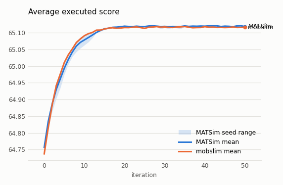
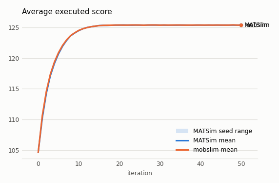
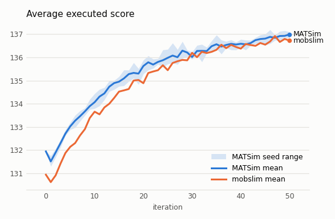

# MATSim verification report

* Generated: 2026-11-05 08:48 UTC
* mobslim: `342cb3f` (dirty)
* MATSim: 2025.0

## Layer 1: scoring

Per-person scores of the same executed day, scored by both sides with the
case's MATSim config (translated by `verification/config.py`).

* **MATSim → mobslim**: MATSim's iteration-0 events, scored by mobslim's
  `CharyparNagelScorer` (`verification/experienced.py` builds the experienced
  plans), against MATSim's executed score in `output_plans`.
* **mobslim → MATSim**: mobslim's QSim run on the same plans, scored by
  mobslim's vectorised `score_trajectories`, against MATSim's
  `EventsToScore` on the same events (`verification/matsim_events.py`
  rewrites them into MATSim's trip structure; `java/ScoreEvents`).

| case / direction | persons | mean (MATSim) | mean Δ | max |Δ| | |Δ|≤1e-6 | stuck |
|---|---|---|---|---|---|---|
| equil-100-uniform.l1: MATSim → mobslim | 100 | 53.1914 | +3.20e-15 🟢 | 1.42e-14 🟢 | 100.0% 🟢 | 0 |
| equil-100-uniform.l1: mobslim → MATSim | 100 | 53.1747 | +3.55e-15 🟢 | 2.84e-14 🟢 | 100.0% 🟢 | 0 |
| equil-100.l1: MATSim → mobslim | 100 | 64.7569 | +3.48e-15 🟢 | 3.55e-14 🟢 | 100.0% 🟢 | 0 |
| equil-100.l1: mobslim → MATSim | 100 | 64.7402 | +3.13e-15 🟢 | 2.84e-14 🟢 | 100.0% 🟢 | 0 |
| equil-2000-cap0.5.l1: MATSim → mobslim | 2000 | 104.6526 | +4.96e-15 🟢 | 5.68e-14 🟢 | 100.0% 🟢 | 0 |
| equil-2000-cap0.5.l1: mobslim → MATSim | 2000 | 104.6517 | +6.67e-15 🟢 | 4.26e-14 🟢 | 100.0% 🟢 | 0 |
| pt-tutorial.l1: MATSim → mobslim | 900 | 131.9468 | +4.58e-15 🟢 | 8.53e-14 🟢 | 100.0% 🟢 | 0 |
| pt-tutorial.l1: mobslim → MATSim | 900 | 130.9342 | +6.00e-15 🟢 | 5.68e-14 🟢 | 100.0% 🟢 | 0 |

## Layer 2: mobsims on fixed plans

Metrics compare each mobslim mobsim (rows: `reference → test`) with a MATSim
mobsim on the same plans and routes (one iteration, no replanning).
`qsim → matsim_hermes` compares MATSim's two mobsims with each other: a yardstick
for how much two faithful queue simulations differ. All are computed from the
events of both sides by the same code (`verification/events_io.py`).

* **GEH<5**: share of (link, hour) volumes with GEH < 5. **vol R²**, **vol Σ|Δ|**:
  hourly link volumes, R² and total absolute difference over total volume.
* **link tt MAE**: mean absolute difference of mean link traversal time per
  (link, 15-min entry bin).
* **trip tt mean Δ**: relative difference of mean door-to-door trip time (a pt
  trip is several legs in MATSim, one in mobslim). **trip tt dist**: distance
  between the two trip time distributions (mean quantile gap).
* **trip |Δ| p95**: 95th percentile of per-trip time differences (trips
  matched by person and index). Large values with small distribution gaps mean
  agents queue in a different order, not that traffic moves differently.
* Transit (pt-tutorial): **pt trip Δ**; **stop arr/dep |Δ|**: mean difference of
  stop arrival and departure times per (departure, stop); **boardings Σ|Δ|**:
  boardings per (departure, stop), total absolute difference over total.
* **veh-h Δ**, **veh-km Δ**: network vehicle-hours and vehicle-km. **stuck**:
  mobslim agents stuck (MATSim's count is in the case header).

Bands (🟢 🟡 🔴) are first guesses, set in `verification/compare.py::BANDS`.

Known differences that affect these numbers (see `VERIFICATION_PLAN.md` §3):

* **D4 departure buffer**: MATSim puts a departing car into the departure
  link's buffer, where it waits for that link's flow capacity; mobslim starts
  it at the link's to-node. Many agents leaving at the same time are released
  over several seconds in MATSim and at once in mobslim.
* **D5 time steps**: MATSim moves vehicles in 1 s steps; mobslim QSim and
  AgentSim are continuous, HermesSim uses whole seconds.
* **D8 transit**: mobslim simulates trips, not vehicles (no `Umlauf`), and in
  `schedule` mode runs them on the timetable rather than in traffic.
* **MATSim Hermes and transit**: on pt-tutorial, MATSim's Hermes runs a
  vehicle's departures route by route, not in time order (3→1 trips start up
  to 17 h late), so it is not used as a transit reference.
* **Tie order**: agents with equal departure times enter queues in a
  different order, so individual legs can differ by minutes while the
  aggregates agree.

### equil-100.l2

100 agents, light congestion: the cleanest baseline. MATSim QSim: 201 trips, 700 car link traversals, 0 stuck, mean trip time 1695 s, run 25.0 s.

| MATSim → test | GEH<5 | vol R² | vol Σ|Δ| | link tt MAE | trip tt mean Δ | trip tt dist | trip |Δ| p95 | veh-h Δ | veh-km Δ | stuck | runtime |
|---|---|---|---|---|---|---|---|---|---|---|---|
| qsim → matsim_hermes | 100.0% 🟢 | 1.0000 🟢 | 0.3% 🟢 | 4.65 s 🟡 | -1.36% 🟢 | 23.1 s 🟡 | 275 s | -1.18% 🟢 | +0.00% 🟢 | 0 | 16.8 s |
| qsim → qsim | 100.0% 🟢 | 1.0000 🟢 | 0.3% 🟢 | 0.48 s 🟢 | +0.01% 🟢 | 0.3 s 🟢 | 311 s | +0.19% 🟢 | +0.00% 🟢 | 0 | 0.02 s |
| hermes → qsim | 100.0% 🟢 | 1.0000 🟢 | 0.0% 🟢 | 4.50 s 🟡 | +1.39% 🟢 | 23.2 s 🟡 | 62 s | +1.39% 🟢 | +0.00% 🟢 | 0 | 0.02 s |
| qsim → agentsim | 100.0% 🟢 | 1.0000 🟢 | 0.3% 🟢 | 0.48 s 🟢 | +0.01% 🟢 | 0.3 s 🟢 | 311 s | +0.19% 🟢 | +0.00% 🟢 | 0 | 0.02 s |
| hermes → agentsim | 100.0% 🟢 | 1.0000 🟢 | 0.0% 🟢 | 4.50 s 🟡 | +1.39% 🟢 | 23.2 s 🟡 | 62 s | +1.39% 🟢 | +0.00% 🟢 | 0 | 0.02 s |
| qsim → agentsim_chain | 100.0% 🟢 | 1.0000 🟢 | 0.3% 🟢 | 0.48 s 🟢 | +0.01% 🟢 | 0.3 s 🟢 | 311 s | +0.19% 🟢 | +0.00% 🟢 | 0 | 0.02 s |
| hermes → agentsim_chain | 100.0% 🟢 | 1.0000 🟢 | 0.0% 🟢 | 4.50 s 🟡 | +1.39% 🟢 | 23.2 s 🟡 | 62 s | +1.39% 🟢 | +0.00% 🟢 | 0 | 0.02 s |
| qsim → hermes | 100.0% 🟢 | 1.0000 🟢 | 0.3% 🟢 | 0.47 s 🟢 | +0.03% 🟢 | 0.5 s 🟢 | 311 s | +0.21% 🟢 | +0.00% 🟢 | 0 | 0.02 s |
| hermes → hermes | 100.0% 🟢 | 1.0000 🟢 | 0.0% 🟢 | 4.55 s 🟡 | +1.41% 🟢 | 23.6 s 🟡 | 63 s | +1.41% 🟢 | +0.00% 🟢 | 0 | 0.02 s |

### equil-2000-cap0.2.l2

2000 agents, flow and storage capacity x0.2: spillback. MATSim QSim: 4000 trips, 14000 car link traversals, 0 stuck, mean trip time 10615 s, run 32.2 s.

| MATSim → test | GEH<5 | vol R² | vol Σ|Δ| | link tt MAE | trip tt mean Δ | trip tt dist | trip |Δ| p95 | veh-h Δ | veh-km Δ | stuck | runtime |
|---|---|---|---|---|---|---|---|---|---|---|---|
| qsim → matsim_hermes | 100.0% 🟢 | 1.0000 🟢 | 0.1% 🟢 | 6.29 s 🟡 | -36.49% 🔴 | 3925.6 s 🔴 | 28787 s | -0.18% 🟢 | +0.00% 🟢 | 0 | 18.6 s |
| qsim → qsim | 98.6% 🟢 | 0.9751 🟢 | 1.6% 🟢 | 205.51 s 🔴 | +0.00% 🟢 | 0.6 s 🟢 | 32385 s | +0.07% 🟢 | +0.00% 🟢 | 0 | 0.47 s |
| hermes → qsim | 98.6% 🟢 | 0.9750 🟢 | 1.5% 🟢 | 205.91 s 🔴 | +57.47% 🔴 | 3926.0 s 🔴 | 16206 s | +0.25% 🟢 | +0.00% 🟢 | 0 | 0.47 s |
| qsim → agentsim | 98.6% 🟢 | 0.9751 🟢 | 1.6% 🟢 | 205.43 s 🔴 | +0.00% 🟢 | 0.6 s 🟢 | 32385 s | +0.07% 🟢 | +0.00% 🟢 | 0 | 0.5 s |
| hermes → agentsim | 98.6% 🟢 | 0.9750 🟢 | 1.5% 🟢 | 205.83 s 🔴 | +57.47% 🔴 | 3926.0 s 🔴 | 16206 s | +0.25% 🟢 | +0.00% 🟢 | 0 | 0.5 s |
| qsim → agentsim_chain | 98.6% 🟢 | 0.9751 🟢 | 1.6% 🟢 | 205.43 s 🔴 | +0.00% 🟢 | 0.6 s 🟢 | 32385 s | +0.07% 🟢 | +0.00% 🟢 | 0 | 0.48 s |
| hermes → agentsim_chain | 98.6% 🟢 | 0.9750 🟢 | 1.5% 🟢 | 205.83 s 🔴 | +57.47% 🔴 | 3926.0 s 🔴 | 16206 s | +0.25% 🟢 | +0.00% 🟢 | 0 | 0.48 s |
| qsim → hermes | 98.6% 🟢 | 0.9752 🟢 | 1.5% 🟢 | 205.49 s 🔴 | +0.00% 🟢 | 0.5 s 🟢 | 32385 s | +0.07% 🟢 | +0.00% 🟢 | 0 | 0.41 s |
| hermes → hermes | 98.6% 🟢 | 0.9750 🟢 | 1.6% 🟢 | 206.78 s 🔴 | +57.47% 🔴 | 3926.1 s 🔴 | 16207 s | +0.25% 🟢 | +0.00% 🟢 | 0 | 0.41 s |

### equil-2000-cap0.5.l2

2000 agents, flow and storage capacity x0.5. MATSim QSim: 4000 trips, 14000 car link traversals, 0 stuck, mean trip time 5218 s, run 39.2 s.

| MATSim → test | GEH<5 | vol R² | vol Σ|Δ| | link tt MAE | trip tt mean Δ | trip tt dist | trip |Δ| p95 | veh-h Δ | veh-km Δ | stuck | runtime |
|---|---|---|---|---|---|---|---|---|---|---|---|
| qsim → matsim_hermes | 93.8% 🟡 | 0.9889 🟢 | 4.7% 🟢 | 22.32 s 🔴 | -22.61% 🔴 | 1207.0 s 🔴 | 11557 s | -1.80% 🟢 | +0.00% 🟢 | 0 | 24.0 s |
| qsim → qsim | 100.0% 🟢 | 1.0000 🟢 | 0.1% 🟢 | 1.25 s 🟢 | +0.00% 🟢 | 0.3 s 🟢 | 12953 s | +0.29% 🟢 | +0.00% 🟢 | 0 | 0.5 s |
| hermes → qsim | 93.8% 🟡 | 0.9904 🟢 | 4.6% 🟢 | 22.30 s 🔴 | +29.22% 🔴 | 1207.2 s 🔴 | 6497 s | +2.13% 🟡 | +0.00% 🟢 | 0 | 0.5 s |
| qsim → agentsim | 100.0% 🟢 | 1.0000 🟢 | 0.1% 🟢 | 1.29 s 🟢 | +0.00% 🟢 | 0.3 s 🟢 | 12953 s | +0.29% 🟢 | +0.00% 🟢 | 0 | 0.52 s |
| hermes → agentsim | 93.8% 🟡 | 0.9904 🟢 | 4.6% 🟢 | 22.20 s 🔴 | +29.22% 🔴 | 1207.2 s 🔴 | 6497 s | +2.13% 🟡 | +0.00% 🟢 | 0 | 0.52 s |
| qsim → agentsim_chain | 100.0% 🟢 | 1.0000 🟢 | 0.1% 🟢 | 1.29 s 🟢 | +0.00% 🟢 | 0.3 s 🟢 | 12953 s | +0.29% 🟢 | +0.00% 🟢 | 0 | 0.51 s |
| hermes → agentsim_chain | 93.8% 🟡 | 0.9904 🟢 | 4.6% 🟢 | 22.20 s 🔴 | +29.22% 🔴 | 1207.2 s 🔴 | 6497 s | +2.13% 🟡 | +0.00% 🟢 | 0 | 0.51 s |
| qsim → hermes | 100.0% 🟢 | 1.0000 🟢 | 0.0% 🟢 | 1.18 s 🟢 | +0.01% 🟢 | 0.4 s 🟢 | 12954 s | +0.30% 🟢 | +0.00% 🟢 | 0 | 0.42 s |
| hermes → hermes | 93.8% 🟡 | 0.9900 🟢 | 4.7% 🟢 | 22.43 s 🔴 | +29.23% 🔴 | 1207.4 s 🔴 | 6497 s | +2.14% 🟡 | +0.00% 🟢 | 0 | 0.42 s |

### equil-2000.l2

2000 agents: queues on the bottleneck links. MATSim QSim: 4000 trips, 14000 car link traversals, 0 stuck, mean trip time 3419 s, run 33.8 s.

| MATSim → test | GEH<5 | vol R² | vol Σ|Δ| | link tt MAE | trip tt mean Δ | trip tt dist | trip |Δ| p95 | veh-h Δ | veh-km Δ | stuck | runtime |
|---|---|---|---|---|---|---|---|---|---|---|---|
| qsim → matsim_hermes | 38.9% 🔴 | 0.8454 🔴 | 20.5% 🔴 | 69.33 s 🔴 | -12.36% 🔴 | 429.3 s 🔴 | 5880 s | -8.68% 🔴 | +0.00% 🟢 | 0 | 22.4 s |
| qsim → qsim | 100.0% 🟢 | 1.0000 🟢 | 0.1% 🟢 | 1.54 s 🟢 | +0.00% 🟢 | 0.4 s 🟢 | 6478 s | +0.74% 🟢 | +0.00% 🟢 | 0 | 0.55 s |
| hermes → qsim | 38.9% 🔴 | 0.8971 🟡 | 20.4% 🔴 | 69.49 s 🔴 | +14.11% 🔴 | 429.5 s 🔴 | 1907 s | +10.32% 🔴 | +0.00% 🟢 | 0 | 0.55 s |
| qsim → agentsim | 100.0% 🟢 | 1.0000 🟢 | 0.1% 🟢 | 1.54 s 🟢 | +0.00% 🟢 | 0.4 s 🟢 | 6478 s | +0.74% 🟢 | +0.00% 🟢 | 0 | 0.55 s |
| hermes → agentsim | 38.9% 🔴 | 0.8971 🟡 | 20.4% 🔴 | 69.41 s 🔴 | +14.11% 🔴 | 429.5 s 🔴 | 1907 s | +10.32% 🔴 | +0.00% 🟢 | 0 | 0.55 s |
| qsim → agentsim_chain | 100.0% 🟢 | 1.0000 🟢 | 0.1% 🟢 | 1.54 s 🟢 | +0.00% 🟢 | 0.4 s 🟢 | 6478 s | +0.74% 🟢 | +0.00% 🟢 | 0 | 0.5 s |
| hermes → agentsim_chain | 38.9% 🔴 | 0.8971 🟡 | 20.4% 🔴 | 69.41 s 🔴 | +14.11% 🔴 | 429.5 s 🔴 | 1907 s | +10.32% 🔴 | +0.00% 🟢 | 0 | 0.5 s |
| qsim → hermes | 100.0% 🟢 | 1.0000 🟢 | 0.0% 🟢 | 1.45 s 🟢 | +0.01% 🟢 | 0.5 s 🟢 | 6478 s | +0.75% 🟢 | +0.00% 🟢 | 0 | 0.42 s |
| hermes → hermes | 38.9% 🔴 | 0.8964 🟡 | 20.5% 🔴 | 70.90 s 🔴 | +14.12% 🔴 | 429.8 s 🔴 | 1908 s | +10.33% 🔴 | +0.00% 🟢 | 0 | 0.42 s |

### pt-tutorial.l2

900 agents, car grid and a train line: mixed traffic, stops, boardings. MATSim QSim: 2228 trips, 4380 car link traversals, 0 stuck, mean trip time 1198 s, 621 boardings, run 35.6 s.

| MATSim → test | GEH<5 | vol R² | vol Σ|Δ| | link tt MAE | trip tt mean Δ | trip tt dist | trip |Δ| p95 | veh-h Δ | veh-km Δ | stuck | pt trip Δ | stop arr |Δ| | stop dep |Δ| | boardings Σ|Δ| | runtime |
|---|---|---|---|---|---|---|---|---|---|---|---|---|---|---|---|
| qsim → qsim/network | 100.0% 🟢 | 1.0000 🟢 | 0.1% 🟢 | 0.79 s 🟢 | -0.19% 🟢 | 2.4 s 🟢 | 6 s | -0.72% 🟢 | +0.00% 🟢 | 0 | -0.05% | 2.0 s 🟡 | 2.0 s 🟡 | 0.0% 🟢 | 0.22 s |
| qsim → agentsim/network | 100.0% 🟢 | 1.0000 🟢 | 0.1% 🟢 | 0.79 s 🟢 | -0.19% 🟢 | 2.4 s 🟢 | 6 s | -0.72% 🟢 | +0.00% 🟢 | 0 | -0.05% | 2.0 s 🟡 | 2.0 s 🟡 | 0.0% 🟢 | 0.21 s |
| qsim → agentsim_chain/network | 100.0% 🟢 | 1.0000 🟢 | 0.1% 🟢 | 0.79 s 🟢 | -0.19% 🟢 | 2.4 s 🟢 | 6 s | -0.72% 🟢 | +0.00% 🟢 | 0 | -0.05% | 2.0 s 🟡 | 2.0 s 🟡 | 0.0% 🟢 | 0.21 s |
| qsim → hermes/network | 100.0% 🟢 | 1.0000 🟢 | 0.1% 🟢 | 0.79 s 🟢 | -0.19% 🟢 | 2.4 s 🟢 | 6 s | -0.72% 🟢 | +0.00% 🟢 | 0 | -0.06% | 2.1 s 🟡 | 2.1 s 🟡 | 0.0% 🟢 | 0.18 s |
| qsim → qsim/schedule | 100.0% 🟢 | 1.0000 🟢 | 0.1% 🟢 | 0.79 s 🟢 | -0.46% 🟢 | 7.3 s 🟢 | 61 s | -0.72% 🟢 | +0.00% 🟢 | 0 | -0.64% | 13.0 s 🔴 | 24.7 s 🔴 | 3.9% 🟡 | 0.2 s |
| qsim → agentsim/schedule | 100.0% 🟢 | 1.0000 🟢 | 0.1% 🟢 | 0.79 s 🟢 | -0.46% 🟢 | 7.3 s 🟢 | 61 s | -0.72% 🟢 | +0.00% 🟢 | 0 | -0.64% | 13.0 s 🔴 | 24.7 s 🔴 | 3.9% 🟡 | 0.21 s |
| qsim → agentsim_chain/schedule | 100.0% 🟢 | 1.0000 🟢 | 0.1% 🟢 | 0.79 s 🟢 | -0.46% 🟢 | 7.3 s 🟢 | 61 s | -0.72% 🟢 | +0.00% 🟢 | 0 | -0.64% | 13.0 s 🔴 | 24.7 s 🔴 | 3.9% 🟡 | 0.19 s |
| qsim → hermes/schedule | 100.0% 🟢 | 1.0000 🟢 | 0.1% 🟢 | 0.79 s 🟢 | -0.46% 🟢 | 7.3 s 🟢 | 61 s | -0.72% 🟢 | +0.00% 🟢 | 0 | -0.64% | 13.0 s 🔴 | 24.7 s 🔴 | 3.9% 🟡 | 0.17 s |

## Layer 3: the full loop

Both sides run the case's MATSim config for the whole loop, each with several
seeds (mobslim's strategies, scoring and mobsim are translated from the
config). Values are for the last iteration. The **MATSim band** is MATSim's
spread over its seeds: **z** is mobslim's mean minus MATSim's mean, in MATSim
standard deviations. 🟢 inside MATSim's min-max range, within 0.1% of its
mean, or |z| ≤ 2; 🟡 |z| ≤ 4; 🔴 beyond. Mode shares are per trip, a pt trip
routed as walk-only counting as `walk` (MATSim's convention). Link volumes: hourly volumes of the last iteration, mobslim seed k
against MATSim seed k, next to MATSim seed k against MATSim seed k+1 (the
floor: how much MATSim differs from itself).

### equil-100.l3

equil, 100 agents, BestScore + ReRoute, 51 iterations. 5 seeds per side, 51 iterations; run time per seed: MATSim 65 s, mobslim 0 s.

| last iteration | MATSim mean ± sd [min, max] | mobslim mean ± sd | Δ | z |
|---|---|---|---|---|
| counts_abs_diff_rel | 0.1562 ± 0.0400 [0.1253, 0.2258] | 0.1481 ± 0.0319 | -0.0081 | -0.2 🟢 |
| score_average | 65.09 ± 0.0008 [65.09, 65.09] | 65.08 ± 0.0019 | -0.0085 | -10.6 🟢 |
| score_best | 65.12 ± 0.0018 [65.12, 65.13] | 65.12 ± 0.0020 | -0.0040 | -2.3 🟢 |
| score_executed | 65.12 ± 0.0013 [65.12, 65.12] | 65.12 ± 0.0016 | -0.0021 | -1.6 🟢 |
| score_worst | 65.04 ± 0.0013 [65.03, 65.04] | 65.02 ± 0.0046 | -0.0194 | -14.9 🟢 |
| trip_tt_mean_s | 1621.37 ± 0.2636 [1621.12, 1621.79] | 1621.34 ± 0.3131 | -0.0366 | -0.1 🟢 |

| link volumes (last iteration) | GEH<5 | R² | Σ|Δ| / total |
|---|---|---|---|
| MATSim vs MATSim (other seed) | 100.0% | 0.9852 | 11.3% |
| mobslim vs MATSim | 100.0% | 0.9870 | 11.3% |

### equil-2000-cap0.5.l3

equil, 2000 agents at capacity x0.5: route choice under congestion. 5 seeds per side, 51 iterations; run time per seed: MATSim 86 s, mobslim 9 s.

| last iteration | MATSim mean ± sd [min, max] | mobslim mean ± sd | Δ | z |
|---|---|---|---|---|
| score_average | 124.55 ± 0.0151 [124.54, 124.58] | 124.54 ± 0.0470 | -0.0093 | -0.6 🟢 |
| score_best | 125.42 ± 0.0212 [125.40, 125.45] | 125.44 ± 0.0189 | +0.0142 | +0.7 🟢 |
| score_executed | 125.39 ± 0.0311 [125.34, 125.41] | 125.37 ± 0.0358 | -0.0188 | -0.6 🟢 |
| score_worst | 122.58 ± 0.0825 [122.47, 122.69] | 122.58 ± 0.1722 | +0.0007 | +0.0 🟢 |
| trip_tt_mean_s | 2047.44 ± 12.10 [2036.78, 2067.76] | 2054.52 ± 13.71 | +7.0791 | +0.6 🟢 |

| link volumes (last iteration) | GEH<5 | R² | Σ|Δ| / total |
|---|---|---|---|
| MATSim vs MATSim (other seed) | 84.2% | 0.9862 | 8.2% |
| mobslim vs MATSim | 76.2% | 0.9844 | 9.3% |

### pt-tutorial.l3

pt-tutorial as shipped: 51 iterations with time and car/pt mode choice. 5 seeds per side, 51 iterations; run time per seed: MATSim 126 s, mobslim 6 s.

| last iteration | MATSim mean ± sd [min, max] | mobslim mean ± sd | Δ | z |
|---|---|---|---|---|
| score_average | 137.70 ± 0.0903 [137.63, 137.86] | 136.74 ± 0.0963 | -0.9598 | -10.6 🔴 |
| score_best | 138.85 ± 0.0430 [138.81, 138.92] | 138.72 ± 0.0493 | -0.1255 | -2.9 🟢 |
| score_executed | 136.99 ± 0.1257 [136.85, 137.10] | 136.72 ± 0.3316 | -0.2682 | -2.1 🟡 |
| score_worst | 135.33 ± 0.1948 [135.06, 135.55] | 131.42 ± 0.2552 | -3.9050 | -20.0 🔴 |
| trip_share_car | 0.8969 ± 0.0040 [0.8918, 0.9013] | 0.8794 ± 0.0167 | -0.0174 | -4.4 🔴 |
| trip_share_pt | 0.0603 ± 0.0038 [0.0557, 0.0655] | 0.0652 ± 0.0059 | +0.0048 | +1.3 🟢 |
| trip_share_walk | 0.0428 ± 0.0039 [0.0395, 0.0494] | 0.0554 ± 0.0112 | +0.0126 | +3.2 🟡 |
| trip_tt_mean_s | 604.82 ± 14.64 [586.48, 620.30] | 640.13 ± 41.29 | +35.3139 | +2.4 🟡 |

| link volumes (last iteration) | GEH<5 | R² | Σ|Δ| / total |
|---|---|---|---|
| MATSim vs MATSim (other seed) | 100.0% | 0.9817 | 12.6% |
| mobslim vs MATSim | 97.3% | 0.9057 | 25.4% |
